# Trợ lý tuyển sinh UTC dùng RAG

Ứng dụng hỏi đáp tuyển sinh bằng tiếng Việt, kèm nguồn để người dùng đối chiếu. Dự án gồm giao diện Next.js và API FastAPI. Bạn tự vận hành dữ liệu, tài khoản quản trị, tệp tài liệu và tìm kiếm vector trên máy chủ của mình. **Gemini là dịch vụ bên ngoài duy nhất trong luồng AI**: ứng dụng gửi câu hỏi và các đoạn tài liệu được chọn cho Gemini để tạo embedding và câu trả lời.

Tài liệu phân tích từng module, luồng xử lý và cấu trúc lưu trữ: [Kiến trúc chi tiết](docs/ARCHITECTURE.md).

## Mục lục

- [Chức năng](#chức-năng)
- [Kiến trúc và luồng dữ liệu](#kiến-trúc-và-luồng-dữ-liệu)
- [Thiết kế database v2 và ERD](#thiết-kế-database-v2-và-erd)
- [Yêu cầu và cấu hình](#yêu-cầu-và-cấu-hình)
- [Chạy trên Windows](#chạy-trên-windows)
- [Chạy trên Linux hoặc macOS](#chạy-trên-linux-hoặc-macos)
- [Sử dụng ứng dụng](#sử-dụng-ứng-dụng)
- [Kế hoạch tuyển sinh cá nhân](#kế-hoạch-tuyển-sinh-cá-nhân)
- [Công cụ nhập dữ liệu](#công-cụ-nhập-dữ-liệu)
- [Bộ đánh giá RAG](#bộ-đánh-giá-rag)
- [API chính](#api-chính)
- [Triển khai và sao lưu](#triển-khai-và-sao-lưu)
- [Dữ liệu từ Supabase cũ](#dữ-liệu-từ-supabase-cũ)
- [Kiểm thử và xử lý lỗi](#kiểm-thử-và-xử-lý-lỗi)

## Chức năng

- **Lưu & tìm lại hội thoại:** `/conversations` tự lưu hội thoại theo tài khoản, đặt tên, tìm tiêu đề/nội dung không dấu và đánh dấu câu trả lời quan trọng. Mở đúng tin nhắn trong hội thoại dài, giữ nguồn trích dẫn và tiếp tục trò chuyện. [Hướng dẫn và phân quyền](docs/CONVERSATIONS.md).

- **Kế hoạch tuyển sinh:** `/score-calculator` tính điểm ba môn tham khảo, `/preferences` lưu/sắp xếp nguyện vọng và đối chiếu điểm chuẩn, `/checklist` quản lý công việc cùng lịch `.ics`. Ba tính năng có mục riêng trên thanh bên. Nguyện vọng/checklist cần đăng nhập; dữ liệu lưu riêng theo tài khoản. [Cách dùng và phạm vi tính điểm](docs/PLANNER.md).

- **Ngành học & điểm chuẩn:** trang `/majors` gộp danh mục, so sánh ngành và điểm chuẩn các năm. Bấm **Xem điểm chuẩn** tại một chương trình để lọc chính xác theo mã xét tuyển và cơ sở; có thể trở lại danh mục mà vẫn giữ bộ lọc và lựa chọn so sánh. `/cutoffs` chuyển tới `/majors?view=cutoffs`.

- **Chat theo ngữ cảnh:** câu hỏi tiếp nối được diễn giải thành câu hỏi độc lập từ tối đa 8 tin nhắn gần nhất của cùng phiên trước khi tìm nguồn. Khi chưa rõ đối tượng, chatbot hỏi lại. Lịch sử không được dùng làm bằng chứng cho câu trả lời.
- **Phạm vi hội thoại:** năm/cơ sở được nêu trong câu hỏi ưu tiên hơn bộ lọc; giao diện cập nhật bộ lọc sau mỗi câu trả lời và khôi phục khi tải lại trang. Thay bộ lọc để đổi phạm vi cho câu tiếp theo. Nút **Cuộc trò chuyện mới** đặt lại phiên, nội dung nhập và bộ lọc; lịch sử cũ không được đưa vào phiên mới.

Khi có lịch sử, mỗi câu hỏi có thêm một lượt gọi Gemini để diễn giải ngữ cảnh. Dữ liệu gửi ở bước này gồm tối đa 8 tin nhắn gần nhất (nội dung mỗi tin giới hạn 2.000 ký tự), câu hỏi đã diễn giải và năm/cơ sở. Database cũ cần chạy migration v2 trước khi mở bằng phiên bản ứng dụng này; các trường ngữ cảnh được giữ lại khi chuyển đổi.

- **Hỏi đáp tuyển sinh:** lọc theo năm và cơ sở Hà Nội/TP. Hồ Chí Minh; hiển thị trích dẫn, liên kết nguồn, lịch sử hội thoại và đánh giá câu trả lời.
- **Kho tài liệu:** quản trị viên xem trước nội dung từ URL hoặc tệp, xác nhận lập chỉ mục, tải lại tệp gốc, tạm ẩn, thử lại khi lập chỉ mục lỗi và xóa tài liệu.
- **Danh mục ngành học:** xem, tìm kiếm, lọc, phân trang; chọn 2–3 chương trình (kể cả ở các trang hoặc bộ lọc khác nhau) để so sánh mã xét tuyển, mã ngành, năm, cơ sở, tổ hợp, phương thức và chỉ tiêu trên cùng một bảng; quản trị viên có thể thêm, sửa, ẩn/hiện, xóa hoặc nhập từ JSON.

Các trang chính: `/` (chat), `/conversations` (lịch sử và câu trả lời đã lưu), `/majors` (ngành học), `/admin` (quản trị). Tài liệu API tự sinh ở `/docs` trên backend.

Các bảng và PDF của tính năng hướng dẫn tân sinh viên cũ được giữ trong database/kho tệp để bảo toàn dữ liệu hiện có; ứng dụng không còn trang hay API truy cập tính năng này.

## Kiến trúc và luồng dữ liệu

```text
Trình duyệt (Next.js)
        │ HTTP
        ▼
FastAPI ───────────► SQLite: tài khoản, phiên, tài liệu, embedding, hội thoại
   │ └─────────────► DATA_DIR/files/: tệp gốc và PDF hướng dẫn
   └───────────────► Gemini API: embedding và sinh câu trả lời
```

Khi quản trị viên thêm tài liệu, backend trích xuất văn bản, chia thành các đoạn khoảng 1.200 ký tự với phần chồng 180 ký tự, gọi Gemini tạo embedding 768 chiều và lưu vào SQLite. Khi có câu hỏi, backend xác định năm/cơ sở, tạo embedding cho câu hỏi, tính độ tương đồng cosine trên các đoạn tài liệu đang hoạt động, lấy tối đa 6 đoạn đạt ngưỡng rồi mới gọi Gemini tạo câu trả lời có nguồn. Nếu không tìm được nguồn phù hợp, ứng dụng trả lời rằng chưa đủ căn cứ.

**Dữ liệu gửi cho Gemini:** câu hỏi, văn bản của các đoạn được chọn và yêu cầu tạo câu trả lời; khi lập chỉ mục, nội dung các đoạn được gửi để tạo embedding. Cơ sở dữ liệu, phiên đăng nhập và tệp gốc nằm trên máy chủ của bạn.

## Thiết kế database v2 và ERD

Database v2 tiếp tục dùng **SQLite**, chuẩn hóa quan hệ tuyển sinh, trích dẫn và embedding theo [skill database-design](https://github.com/MoizIbnYousaf/ai-agent-skills/blob/main/skills/database-design/SKILL.md). DDL có thể chạy trên database trống tại [`backend/schema/v2.sql`](backend/schema/v2.sql); quyết định thiết kế và lộ trình migration tại [Database v2](docs/DATABASE-V2.md).

**Trạng thái:** runtime đã dùng schema v2; database trống được khởi tạo tự động. Với database cũ, dừng backend và các tiến trình ghi rồi chạy `backend/scripts/migrate_database.py` theo [hướng dẫn migration](docs/DATABASE-V2.md#chạy-migration). Không chạy DDL trực tiếp lên database có dữ liệu. API giữ nguyên các trường JSON hiện tại thông qua lớp adapter.

```mermaid
erDiagram
    accounts ||--o{ auth_sessions : authenticates
    accounts ||--o| planner_revisions : versions
    accounts ||--o{ planner_preferences : plans
    accounts ||--o{ planner_tasks : tracks
    accounts o|--o{ admission_score_rules : publishes
    admission_offerings o|--o{ planner_preferences : snapshots
    campuses ||--o{ planner_preferences : scopes
    campuses ||--o{ admission_score_rules : applies
    accounts o|--o{ chat_sessions : owns
    accounts o|--o{ documents : creates
    campuses ||--o{ admission_offerings : hosts
    admission_offerings ||--o| major_catalogue : describes
    admission_offerings ||--o{ cutoff_scores : has
    admission_methods ||--o{ cutoff_scores : scores
    major_catalogue ||--o{ offering_methods : accepts
    admission_methods ||--o{ offering_methods : defines
    major_catalogue ||--o{ offering_subject_groups : accepts
    campuses ||--o{ documents : scopes
    campuses o|--o{ messages : contextualizes
    documents ||--o{ document_chunks : contains
    document_chunks ||--o{ chunk_embeddings : embeds
    embedding_models ||--o{ chunk_embeddings : produces
    chat_sessions ||--o{ messages : contains
    chat_sessions ||--|| conversation_metadata : describes
    accounts ||--o{ conversation_bookmarks : saves
    messages ||--o| conversation_bookmarks : bookmarks
    messages ||--o{ message_citations : cites
    document_chunks o|--o{ message_citations : references
    messages ||--o| feedback : receives
    freshman_guides ||--o{ freshman_items : contains

    conversation_metadata {
        text session_id PK,FK
        text title
        bool is_title_custom
        text updated_at
    }
    conversation_bookmarks {
        text message_id PK,FK
        text account_id FK
        text created_at
    }
    planner_revisions {
        text account_id PK,FK
        int revision
    }
    planner_preferences {
        text id PK
        text account_id FK
        text offering_id FK
        int admission_year
        text campus FK
        int position
        text method
        real estimated_score
        int score_scale
    }
    planner_tasks {
        text id PK
        text account_id FK
        int admission_year
        text due_date
        bool completed
        text template_key
    }
    admission_score_rules {
        text id PK
        text published_by FK
        text campus FK
        int admission_year
        text subject_group
        text priority_mode
        text source_url
        bool is_active
    }
    accounts {
        text id PK
        text email UK
        text role
        text password_hash
    }
    auth_sessions {
        text token_hash PK
        text account_id FK
        text expires_at
    }
    campuses {
        text code PK
        text name
    }
    admission_offerings {
        text id PK
        int admission_year
        text campus_code FK
        text admission_code
        text program_name
    }
    major_catalogue {
        text id PK,FK
        text major_code
        text name
        int quota
        bool is_active
    }
    admission_methods {
        text code PK
        text name
    }
    offering_methods {
        text offering_id PK,FK
        text method_code PK,FK
    }
    offering_subject_groups {
        text offering_id PK,FK
        text group_code PK
    }
    cutoff_scores {
        text offering_id PK,FK
        text method_code PK,FK
        real score
        int scale
        text source_url
        text program_name_snapshot
    }
    documents {
        text id PK
        text campus_code FK
        text created_by FK
        text checksum UK
        text status
        text storage_path
    }
    document_chunks {
        text id PK
        text document_id FK
        int chunk_index
        text content
    }
    embedding_models {
        text id PK
        text provider
        text model_name
        int dimensions
    }
    chunk_embeddings {
        text chunk_id PK,FK
        text model_id PK,FK
        text vector
    }
    chat_sessions {
        text id PK
        text account_id FK
        text token_hash UK
    }
    messages {
        text id PK
        text session_id FK
        text context_campus FK
        text role
        text content
    }
    message_citations {
        text message_id PK,FK
        int citation PK
        text chunk_id FK
        text source_snapshot
    }
    feedback {
        text id PK
        text message_id FK,UK
        int rating
    }
    freshman_guides {
        text id PK
        text cohort UK
        text storage_path
    }
    freshman_items {
        text id PK
        text guide_id FK
        text category
        text code
    }
```



ERD lược bớt thuộc tính; DDL là định nghĩa đầy đủ. Khóa duy nhất của đợt tuyển sinh là `(admission_year, campus_code, admission_code)`. `major_catalogue.id` đồng thời là khóa ngoại, nên điểm chuẩn lịch sử có thể tồn tại khi chưa có danh mục chi tiết cho năm đó. `schema_migrations` và `api_rate_limits` là bảng kỹ thuật độc lập, không vẽ trong sơ đồ nghiệp vụ.

## Yêu cầu và cấu hình

- Python **3.11+**, Node.js **22+**, npm.
- Gemini API key có quyền dùng model chat và embedding đã cấu hình.
- Một thư mục dữ liệu có quyền ghi cho tiến trình backend.
- Không cần tài khoản hoặc dự án Supabase cho bản chạy mới.

### Biến môi trường backend

Tạo `backend/.env` từ `backend/.env.example`. Nếu đã có file `.env`, cập nhật các biến dưới đây và bỏ các biến `SUPABASE_*` cũ sau khi đã sao lưu/migrate dữ liệu cần giữ.

| Biến | Ý nghĩa | Giá trị mẫu/mặc định |
| --- | --- | --- |
| `DATA_DIR` | Thư mục chứa `utc.sqlite3` và `files/`; đường dẫn tương đối tính từ thư mục chạy backend | `data/local` |
| `ADMIN_EMAIL` | Email tạo tài khoản quản trị đầu tiên | `admin@example.com` |
| `ADMIN_PASSWORD` | Mật khẩu ban đầu, **ít nhất 16 ký tự**, phải thay giá trị mẫu `CHANGE_ME...` | Tự đặt |
| `GOOGLE_API_KEY` | Khóa Gemini, chỉ đặt ở backend | Tự cấp |
| `GEMINI_MODEL` | Model tạo câu trả lời | `gemini-2.5-flash` |
| `EMBEDDING_MODEL` | Model tạo embedding | `gemini-embedding-001` |
| `EMBEDDING_DIMENSIONS` | Số chiều vector, phải khớp dữ liệu/model đã chọn | `768` |
| `FRONTEND_ORIGIN` | Origin được phép gọi API qua CORS | `http://localhost:3000` |
| `SIMILARITY_THRESHOLD` | Ngưỡng tương đồng tối thiểu khi tìm đoạn nguồn | `0.65` |
| `RATE_LIMIT_GLOBAL` | Tổng yêu cầu API mỗi phút theo IP | `120` |
| `RATE_LIMIT_CHAT` | Yêu cầu `POST /chat` mỗi phút theo IP | `20` |
| `RATE_LIMIT_LOGIN` | Lần thử `POST /admin/login` mỗi phút theo IP | `5` |
| `RATE_LIMIT_ADMIN_WRITE` | Thao tác ghi `/admin/*` mỗi phút theo IP | `30` |

Tài khoản quản trị được tạo vào **lần đăng nhập đầu tiên**. Mật khẩu được lưu trong SQLite dưới dạng hash scrypt có salt; token đăng nhập hết hạn sau 12 giờ. Sau khi tạo tài khoản, có thể bỏ `ADMIN_PASSWORD` khỏi môi trường. Chỉ sửa biến này trong `.env` **không đổi** mật khẩu của tài khoản đã có; xem mục [Đổi mật khẩu quản trị](#đổi-mật-khẩu-quản-trị).

`GET /health` trả `configured: true` khi đã có tài khoản quản trị trong SQLite và đã cấu hình `GOOGLE_API_KEY`. Trước lần đăng nhập đầu tiên, `configured` vẫn là `false`.

### Biến môi trường frontend

Chỉ cần `NEXT_PUBLIC_API_URL`, ví dụ `http://localhost:8000`. Đặt trong `frontend/.env.local` hoặc cập nhật `frontend/.env` đang có. **Không đặt** mật khẩu quản trị, khóa Gemini hay khóa cơ sở dữ liệu trong biến `NEXT_PUBLIC_*`, vì các biến này xuất hiện ở trình duyệt.

## Chạy trên Windows

Mở PowerShell tại thư mục gốc dự án:

```powershell
cd backend
python -m venv .venv
.venv\Scripts\python -m pip install -r requirements.txt
if (-not (Test-Path .env)) { Copy-Item .env.example .env }
```

Sửa `backend/.env`: đặt `ADMIN_EMAIL`, `ADMIN_PASSWORD` riêng (ít nhất 16 ký tự) và `GOOGLE_API_KEY`. Nếu file đã tồn tại, không chạy lệnh `Copy-Item` ghi đè mà chỉ bổ sung các biến cần thiết. Sau đó chạy API từ thư mục `backend`:

```powershell
.venv\Scripts\python -m uvicorn app.main:app --reload --port 8000
```

Mở PowerShell thứ hai tại thư mục gốc:

```powershell
cd frontend
npm.cmd ci
if (-not (Test-Path .env.local)) { Copy-Item .env.example .env.local }
npm.cmd run dev
```

Nếu `frontend/.env.local` đã tồn tại, chỉ cần kiểm tra `NEXT_PUBLIC_API_URL` thay vì ghi đè. Mở <http://localhost:3000>; trang quản trị ở <http://localhost:3000/admin>; API ở <http://localhost:8000/docs>.

## Chạy trên Linux hoặc macOS

Từ thư mục gốc dự án:

```bash
cd backend
python3 -m venv .venv
.venv/bin/python -m pip install -r requirements.txt
test -f .env || cp .env.example .env
# Sửa ADMIN_EMAIL, ADMIN_PASSWORD và GOOGLE_API_KEY trong .env.
.venv/bin/python -m uvicorn app.main:app --reload --port 8000
```

Trong terminal khác:

```bash
cd frontend
npm ci
test -f .env.local || cp .env.example .env.local
npm run dev
```

Nếu `.env` hoặc `.env.local` đã tồn tại, cập nhật file hiện có thay vì ghi đè. Các đường dẫn tương đối trong cấu hình backend phụ thuộc vào thư mục làm việc; các lệnh trên giả định API được chạy từ `backend`.

## Sử dụng ứng dụng

### Nạp tài liệu cho chatbot

1. Vào `/admin`, đăng nhập bằng tài khoản cục bộ.
2. Nhập tiêu đề, URL nguồn chính thức, năm tuyển sinh và cơ sở.
3. Chọn PDF/TXT/Markdown hoặc để trống tệp để đọc nội dung trực tiếp từ URL. Bấm **Trích xuất & xem trước**.
4. Kiểm tra/chỉnh văn bản trích xuất, rồi bấm **Xác nhận & lập chỉ mục**.
5. Chờ trạng thái `ready`. Nếu là `failed`, kiểm tra cấu hình Gemini/hạn mức API rồi dùng **Thử lại**.

Giới hạn hiện tại: tệp tối đa **10 MB**, PDF tối đa **300 trang**, văn bản phải có ít nhất **30 ký tự**, tài liệu tối đa **2.000 đoạn**. PDF scan cần OCR trước. URL nguồn phải dùng HTTPS và thuộc một trong các tên miền được cho phép: `tuyensinh.utc.edu.vn`, `www.utc.edu.vn`, `utc.edu.vn`, `utc2.edu.vn`, `www.utc2.edu.vn`. Việc đọc URL không theo chuyển hướng. Tệp tải lên vẫn cần URL nguồn để trích dẫn.

Một tài liệu chỉ được lập chỉ mục một lần cho cùng năm, cơ sở và nội dung. Chỉ các tài liệu có trạng thái `ready` tham gia tìm kiếm. Admin có thể chuyển giữa `ready` và `inactive`.

### Lưu và tìm lại hội thoại

Đăng nhập để các cuộc trò chuyện mới được lưu vào tài khoản. Mở **Lịch sử hội thoại** trên sidebar để đổi tên, tìm không dấu theo tiêu đề/nội dung và mở lại đúng tin nhắn. Bấm **Lưu câu trả lời** trong chat để giữ thông tin quan trọng. Có thể tiếp tục hội thoại trên thiết bị khác sau khi đăng nhập. Khách giữ phiên hiện tại trên trình duyệt; không tự gắn phiên khách khi đăng nhập. Xem [hướng dẫn đầy đủ](docs/CONVERSATIONS.md).

### Hỏi đáp và phản hồi

Chọn năm/cơ sở trên trang chủ rồi gửi câu hỏi, không cần đăng ký hoặc đăng nhập. Nếu câu hỏi nêu rõ một năm hoặc cơ sở, backend ưu tiên thông tin trong câu hỏi; câu hỏi trộn nhiều năm hoặc cả hai cơ sở sẽ bị yêu cầu tách riêng. Khi gửi câu hỏi đầu tiên, backend tạo một token phiên chat ngẫu nhiên; trình duyệt lưu token này trong `localStorage` để xem lại lịch sử trên cùng trình duyệt. Nút **Cuộc trò chuyện mới** bỏ token hiện tại và tạo phiên mới ở lần gửi tiếp theo. Đánh giá hữu ích/chưa hữu ích chỉ ghi cho câu trả lời của đúng phiên. Với hội thoại đã đăng nhập, có thể mở lại bằng tài khoản từ Lịch sử; không cần giữ token phiên gốc. Token phiên khách là bí mật truy cập lịch sử: ai có token có thể xem hội thoại đó, nên tránh chia sẻ hoặc nhập trên thiết bị công cộng.

### Quản lý ngành học

Tại `/admin`, dùng tab **Ngành học** để quản lý danh mục hoặc nhập JSON. Danh mục ngành học **không tự trở thành nguồn RAG**; muốn chatbot dùng dữ liệu mới, hãy nạp tài liệu nguồn tương ứng vào kho tài liệu.

### Đổi mật khẩu quản trị

Chạy từ `backend`:

```powershell
.venv\Scripts\python scripts/set_admin_password.py
```

Trên Linux/macOS, thay bằng `.venv/bin/python scripts/set_admin_password.py`. Script hỏi email và mật khẩu mới, yêu cầu ít nhất 16 ký tự, rồi thu hồi mọi phiên quản trị đang tồn tại.

## Kế hoạch tuyển sinh cá nhân

Mở **Tính điểm xét tuyển** (`/score-calculator`), **Nguyện vọng cá nhân** (`/preferences`) hoặc **Checklist & lịch** (`/checklist`) từ thanh bên. Tính điểm ba môn, ưu tiên đã điều chỉnh và điểm cộng trong chế độ tham khảo; quản trị viên có thể đăng công thức đã đối chiếu nguồn cho đúng năm/cơ sở. Chưa có công thức chính thức được gieo sẵn, nên chế độ tự tính không xác nhận điểm xét tuyển chính thức.

Đăng nhập để tìm/lưu ngành, đổi thứ tự nguyện vọng, lưu điểm dự kiến và ghi chú. Tạo checklist gợi ý hoặc thêm việc riêng, đặt ngày, đánh dấu hoàn thành và tải lịch `.ics`. Ngày do bạn đặt; công cụ không tự đăng ký nguyện vọng hoặc gửi thông báo. Xem [hướng dẫn đầy đủ, công thức và API](docs/PLANNER.md).

Sau migration v2, bản cập nhật tự thêm các bảng planner trong transaction khi kết nối database; giữ nguyên dữ liệu hiện có. DDL bổ sung: [`backend/schema/planner.sql`](backend/schema/planner.sql).

## Công cụ nhập dữ liệu

Các script sau có chế độ kiểm tra trước; thêm `--apply` mới ghi vào SQLite. Chạy từ `backend` để dùng đúng `DATA_DIR`.

**Dữ liệu tuyển sinh chính quy 2026:** [`backend/data/majors_2026.json`](backend/data/majors_2026.json) gồm 56 mã xét tuyển GHA (Hà Nội) và 29 mã GSA (TP.HCM), trích từ [thông tin tuyển sinh 2026 của trường](https://tuyensinh.utc.edu.vn/?q=tin-tuyen-sinh/th%C3%B4ng-tin-tuy%E1%BB%83n-sinh-%C4%91%E1%BA%A1i-h%E1%BB%8Dc-h%E1%BB%87-ch%C3%ADnh-quy-2026). Tệp lưu mã xét tuyển, mã ngành, tên chương trình/ngành, chỉ tiêu dự kiến, phương thức, tổ hợp và điều kiện bổ sung. Riêng hai chương trình liên kết quốc tế dùng thông báo tuyển sinh riêng nên không có tổ hợp trong bảng chính. Để nạp dữ liệu trên máy mới, từ thư mục `backend` chạy:

```powershell
.venv\Scripts\python scripts/import_majors.py data/majors_2026.json
.venv\Scripts\python scripts/import_majors.py data/majors_2026.json --apply
```

Lệnh đầu chỉ kiểm tra; `--apply` mới ghi SQLite. Tệp là dữ liệu năm 2026, không đại diện cho các năm hoặc hệ đào tạo khác.

**Danh mục ngành từ JSON** (định dạng có `metadata.source_url` và mục `chi_tieu_YYYY`):

```powershell
.venv\Scripts\python scripts/import_majors.py "duong-dan\majors.json"
.venv\Scripts\python scripts/import_majors.py "duong-dan\majors.json" --apply
```

Dữ liệu đã có cùng năm, cơ sở và mã xét tuyển được bỏ qua; các sửa đổi của admin được giữ lại.

## Bộ đánh giá RAG

Bộ đánh giá nằm ở `backend/app/evaluation.py`, chạy bằng `backend/scripts/evaluate_rag.py`. Nó dùng **cùng bộ lọc năm/cơ sở, model embedding, ngưỡng tương đồng và top 6 đoạn** như API `POST /chat`. Lệnh chỉ đọc kho tài liệu; không tạo phiên chat hay ghi phản hồi.

### Chuẩn bị bộ câu hỏi

Sao chép `backend/evaluations/dataset.example.json` thành một file JSON riêng và sửa các câu hỏi cho phù hợp tài liệu đã nạp. File mẫu chỉ minh họa cấu trúc; URL có đoạn `duong-dan-tai-lieu-da-nap` phải được thay bằng **URL nguồn chính xác** của một tài liệu trạng thái `ready` trong `/admin`.

Mỗi câu trong `cases` cần `id` duy nhất, `question`, `year`, `campus` (`hanoi` hoặc `hcm`) và `expect_supported`:

- Nếu `expect_supported: true`, điền ít nhất một URL vào `expected_source_urls`. Có thể thêm `required_answer_phrases` để kiểm tra các cụm từ cần xuất hiện trong câu trả lời.
- Có thể điền `expected_answer` làm đáp án tham chiếu để người đọc đối chiếu trong báo cáo. Công cụ không chấm mức độ giống nhau về ngữ nghĩa với đáp án này; điều kiện tự động cho nội dung trả lời là các cụm từ trong `required_answer_phrases`. Với câu hỏi phải từ chối, không đặt `expected_answer`.
- Nếu `expect_supported: false`, để hai danh sách trên rỗng. Trường hợp này kiểm tra chatbot có từ chối khi thiếu căn cứ hay không; nó không yêu cầu bước truy xuất trả về 0 đoạn.
- URL kỳ vọng được so khớp **chính xác** với `source_url` đã lưu. Cụm từ đáp án được kiểm tra theo chuỗi, không phân biệt chữ hoa/thường và khoảng trắng thừa; đây là phép kiểm tra đơn giản, **không thay thế đánh giá đúng sai ngữ nghĩa** của người đọc.

Nên có cả câu hỏi có nguồn rõ ràng, câu hỏi về năm/cơ sở khác nhau và câu hỏi phải từ chối. Sau khi quản trị viên thay tài liệu hoặc đổi cách tìm kiếm/prompt, chạy lại **cùng một file JSON** để so sánh.

### Chạy đánh giá

Chạy từ thư mục `backend` sau khi cấu hình `GOOGLE_API_KEY` và nạp tài liệu:

```powershell
.venv\Scripts\python scripts/evaluate_rag.py evaluations/dataset.example.json
.venv\Scripts\python scripts/evaluate_rag.py evaluations/dataset.example.json --retrieval-only
```

Lần đầu chạy, hãy thay URL mẫu trước. `--retrieval-only` chỉ bỏ bước sinh câu trả lời; bước tạo embedding câu hỏi vẫn gọi Gemini. Ở chế độ đầy đủ, cả embedding lẫn sinh câu trả lời có thể tiêu thụ hạn mức API. Trên Linux/macOS, dùng `.venv/bin/python`.

Mỗi lần chạy tạo báo cáo JSON có dấu thời gian tại `DATA_DIR/evaluations/`; dùng `--output duong-dan/bao-cao.json` nếu muốn chọn đường dẫn khác. Báo cáo chứa câu hỏi, câu trả lời, URL nguồn và điểm từng câu; hãy giữ thư mục này riêng tư. Báo cáo không chứa API key hoặc toàn văn các đoạn truy xuất.

Để so với báo cáo trước và dùng trong CI:

```powershell
.venv\Scripts\python scripts/evaluate_rag.py evaluations/dataset.example.json --baseline "duong-dan\run-cu.json"
.venv\Scripts\python scripts/evaluate_rag.py evaluations/dataset.example.json --fail-below 1.0
```

`--baseline` yêu cầu cùng bộ câu hỏi, cùng chế độ và cùng model embedding; kết quả in phần chênh lệch của các chỉ số. `--fail-below` trả mã thoát 1 nếu tỷ lệ đạt thấp hơn ngưỡng, còn lỗi chạy câu hỏi trả mã 2.

### Cách đọc kết quả

| Chỉ số | Ý nghĩa |
| --- | --- |
| `retrieval_hit_at_6` | Tỷ lệ câu hỏi cần trả lời có ít nhất một URL kỳ vọng trong 6 đoạn truy xuất. |
| `mean_reciprocal_rank` | Trung bình `1 / vị trí` của nguồn kỳ vọng đầu tiên; nguồn xuất hiện sớm được điểm cao hơn. |
| `support_accuracy` | Tỷ lệ dự đoán đủ/không đủ căn cứ đúng theo `expect_supported`. |
| `citation_hit_rate` | Tỷ lệ câu hỏi cần trả lời có ít nhất một trích dẫn thuộc URL kỳ vọng. |
| `phrase_pass_rate` | Tỷ lệ câu có cụm từ bắt buộc mà câu trả lời chứa đủ các cụm từ đó. |
| `pass_rate` | Tỷ lệ câu đạt tất cả điều kiện áp dụng cho câu đó. Ở chế độ chỉ truy xuất, chỉ các câu `expect_supported: true` tham gia mẫu số. |

Nếu `retrieval_hit_at_6` thấp, kiểm tra tài liệu, bộ lọc, embedding và ngưỡng. Nếu truy xuất đúng nhưng `citation_hit_rate` hoặc `phrase_pass_rate` thấp, kiểm tra cách tạo câu trả lời và nội dung nguồn. Luôn đọc các câu bị đánh dấu `FAIL` trong báo cáo trước khi sửa hệ thống.


## Phân quyền quản trị và giới hạn API

Website có bốn vai trò. Đăng nhập/đăng ký/đổi mật khẩu tại `/account`; quyền luôn được backend kiểm tra lại ở mỗi request. Khách không cần tài khoản; đăng ký công khai chỉ tạo sinh viên, giảng viên do admin cấp.

| Vai trò | Xem dữ liệu và phản hồi quản trị | Thêm/sửa/xóa tài liệu, ngành, hướng dẫn | Quản lý tài khoản |
| --- | --- | --- | --- |
| `guest` (khách) | Không | Không | Không |
| `student` (sinh viên) | Không | Không | Không |
| `lecturer` (giảng viên) | Có | Có | Không |
| `admin` | Có | Có | Có |

Tất cả vai trò đều có thể tra cứu ngành/điểm chuẩn, hướng dẫn và chat. Tài khoản từ `ADMIN_EMAIL`/`ADMIN_PASSWORD` có vai trò `admin`. Admin thêm tài khoản trong tab **Tài khoản** hoặc qua `POST /admin/accounts` (email, mật khẩu tối thiểu 16 ký tự, role), xem danh sách với `GET /admin/accounts`, đổi vai trò, khóa/mở khóa hoặc đặt lại mật khẩu qua `PATCH /admin/accounts/{id}`. Đổi quyền, khóa tài khoản hoặc đổi mật khẩu thu hồi toàn bộ phiên của tài khoản đó. Hệ thống không cho tự hạ quyền/khóa admin đang đăng nhập hoặc xóa quyền admin hoạt động cuối cùng.

Auth dùng `POST /auth/login`, `POST /auth/logout`, `GET /auth/me`, `POST /auth/register` và `POST /auth/password`. Các endpoint `/admin/login` và `/admin/logout` cũ vẫn là alias tương thích. Database dùng `accounts`, `auth_sessions`, `schema_migrations`; bảng cũ được giữ lại nhưng không dùng để xác thực. Migration một lần giữ ID, email, mật khẩu hash và trạng thái; ánh xạ `editor → lecturer`, `viewer → student`, `admin → admin`. Phiên cũ yêu cầu đăng nhập lại. Chat tạo khi đăng nhập gắn `account_id` và chỉ chủ tài khoản mới truy cập được bằng cả Bearer token và X-Session-Token.

Tạo 3 dòng dữ liệu tài khoản mẫu bằng lệnh dưới đây trong thư mục `backend`:

```powershell
.venv/Scripts/python.exe scripts/seed_auth.py
```

Script tạo `student.demo@utc.local`, `lecturer.demo@utc.local`, `admin.demo@utc.local` với mật khẩu ngẫu nhiên riêng. Mật khẩu được lưu trong `DATA_DIR/auth-demo-credentials.local.json` (đã được gitignore), không in ra log. Chạy lại không thay tài khoản hay mật khẩu. Nếu database đã tồn tại, script lưu backup `utc.before-auth-v1.sqlite3.bak` trước khi mở migration. Tài liệu chi tiết: [Auth & RBAC](docs/AUTH.md).

Middleware dùng SQLite để đếm yêu cầu theo IP trong cửa sổ 60 giây, dùng chung giữa các tiến trình trỏ tới cùng `DATA_DIR`. Mọi API chịu ngưỡng tổng; `/chat`, `/admin/login` và các thao tác ghi `/admin/*` chịu thêm ngưỡng riêng. Đặt ngưỡng bằng các biến `RATE_LIMIT_*` ở trên; giá trị `0` tắt riêng ngưỡng đó. Vượt ngưỡng nhận HTTP `429` với `Retry-After`, `X-RateLimit-Limit`, `X-RateLimit-Remaining`, `X-RateLimit-Reset`. CORS preflight và tài liệu OpenAPI không bị tính. Backend dùng IP do ASGI server cung cấp, không tự tin header `X-Forwarded-For`; khi chạy sau reverse proxy, cấu hình proxy tin cậy trên Uvicorn và giới hạn truy cập trực tiếp vào backend.

## Tra cứu điểm chuẩn các năm

Mở `/cutoffs` từ thanh điều hướng bên trái để chọn ngành/chương trình, năm, cơ sở và phương thức bằng bốn dropdown. Bảng hiển thị điểm, **thang điểm**, tiêu chí phụ và liên kết đến thông báo chính thức của trường. Chức năng công khai, không cần đăng nhập. Dữ liệu gồm 558 mức điểm từ các thông báo tuyển sinh chính quy **2024, 2025 và 2026** cho Hà Nội và phân hiệu TP. Hồ Chí Minh. Những ô trường không công bố điểm không được tạo thành bản ghi.

| Năm | Số mức điểm | Nguồn chính thức |
| --- | ---: | --- |
| 2024 | 92 | [Thông báo 659 của UTC](https://www.utc.edu.vn/Upload/FilePost/2024/08/17/659-thong-bao-chinh-quy-2024.pdf) |
| 2025 | 211 | [Thông báo 653 của UTC](https://utc.edu.vn/Upload/FilePost/2025/08/23/653-diem-trung-tuyen-he-dai-hoc-chinh-quy.pdf) |
| 2026 | 255 | [Thông báo GHA của UTC](https://tuyensinh.utc.edu.vn/?q=node/33061), [thông báo GSA của UTC2](https://tuyensinh.utc2.edu.vn/vi/thong-bao-ve-viec-cong-bo-diem-chuan-dai-hoc-chinh-quy-nam-2026-2460) |

Dữ liệu nguồn nằm trong `backend/data/cutoffs_2024_2026.json`. Các bảng đăng trên thông báo chính thức được đối chiếu với bản chép dạng HTML để tạo JSON; từng dòng lưu URL thông báo gốc của trường và tiêu chí phụ. Mã phương thức được thống nhất: `PT1` = điểm thi THPT, `PT2` = học bạ, `PT3` = đánh giá năng lực, `PT4` = đánh giá tư duy. **Không so sánh trực tiếp điểm giữa các thang 30, 100, 150 và 1200**, hoặc giữa các năm khi quy chế quy đổi thay đổi.

Sau khi tạo SQLite mới hoặc cập nhật dữ liệu, chạy từ thư mục `backend`:

```powershell
.venv\Scripts\python scripts/import_cutoffs.py data/cutoffs_2024_2026.json
.venv\Scripts\python scripts/import_cutoffs.py data/cutoffs_2024_2026.json --apply
```

Lệnh đầu kiểm tra dữ liệu, lệnh `--apply` thêm bản ghi vào `DATA_DIR/utc.sqlite3`. Nhập lại sẽ bỏ qua khóa trùng `(năm, cơ sở, mã xét tuyển, phương thức)` và giữ dữ liệu đã có. API `GET /cutoffs` hỗ trợ `major` (tên ngành/chương trình chính xác), `q` (tìm từ khóa), `year`, `campus`, `method`, `page`, `page_size`; `GET /cutoffs/options` cung cấp ngành, năm và phương thức có dữ liệu. `q` tìm không phân biệt dấu tiếng Việt. Khi trường công bố thông báo mới hoặc đính chính, cập nhật JSON và kiểm tra lại từng dòng trước khi nhập; bản ghi đã có cần được sửa có chủ đích trong SQLite vì bộ nhập không tự ghi đè.

## API chính

| Nhóm | Endpoint | Công dụng |
| --- | --- | --- |
| Hệ thống | `GET /health` | Trạng thái và cờ cấu hình |
| Lịch sử riêng | `/conversations`, `/conversations/{id}/messages`, `/conversations/bookmarks` | Tìm/đổi tên/mở lại hội thoại và lưu câu trả lời; yêu cầu đăng nhập |
| Chat | `POST /sessions`, `GET /messages`, `POST /chat`, `POST /feedback` | Tạo phiên ẩn danh, lịch sử, hỏi đáp, đánh giá |
| Quản trị | `POST /admin/login`, `POST /admin/logout` | Đăng nhập, đăng xuất |
| Tài liệu | `GET/POST /admin/documents`, `POST /admin/documents/preview`, `POST /admin/documents/upload` | Danh sách, thêm và xem trước |
| Tài liệu | `GET /admin/documents/{id}/download`, `PATCH/DELETE /admin/documents/{id}`, `POST /admin/documents/{id}/retry` | Tải tệp gốc và quản lý trạng thái |
| Rà soát | `GET /admin/review` | Phản hồi và câu trả lời thiếu nguồn |
| Điểm chuẩn | `GET /cutoffs`, `GET /cutoffs/options` | Tra cứu lịch sử điểm trúng tuyển và bộ lọc |
| Ngành học | `GET /majors`, `GET /majors/{id}`, `/admin/majors/*` | Tra cứu và quản trị |

Các endpoint `/admin/*` cần `Authorization: Bearer <token>` của quản trị viên, ngoại trừ `/admin/login`. `POST /sessions` không cần xác thực và trả token phiên. `GET /messages`, `POST /chat` và `POST /feedback` cần header `X-Session-Token` lấy từ phiên đó; đây là token riêng cho lịch sử chat, không cấp quyền quản trị. Xem schema yêu cầu/phản hồi đầy đủ tại `/docs`.

## Triển khai và sao lưu

- Build frontend bằng `npm ci && npm run build`, sau đó chạy `npm run start`. Chạy backend với `uvicorn app.main:app --port 8000` từ thư mục `backend`; trong môi trường production không dùng `--reload`.
- Đặt reverse proxy và HTTPS trước frontend/backend. Cập nhật `FRONTEND_ORIGIN` theo **origin** frontend công khai, và `NEXT_PUBLIC_API_URL` theo URL backend công khai. Build lại frontend nếu đổi biến `NEXT_PUBLIC_*`.
- Đặt `DATA_DIR` thành đường dẫn **tuyệt đối**, ổn định, nằm ngoài thư mục mã nguồn. Thư mục phải riêng tư và tiến trình backend phải có quyền đọc/ghi.
- Chạy một instance backend dùng SQLite. Tìm kiếm vector hiện tính cosine trên các đoạn phù hợp trong SQLite; bộ tài liệu rất lớn có thể cần một chỉ mục vector tự host riêng.
- Để sao lưu nhất quán, dừng backend rồi sao chép **toàn bộ** `DATA_DIR`, gồm `utc.sqlite3` và `files/`. Khôi phục cả hai vào cùng `DATA_DIR` trước khi khởi động lại. Thử khôi phục trên máy kiểm thử trước khi dùng bản sao lưu.
- Không commit `.env`, khóa Gemini, mật khẩu hoặc `DATA_DIR`. `.gitignore` đã loại các file `.env` thông thường và `backend/data/local/`; với đường dẫn dữ liệu tùy chỉnh, cần tự bảo vệ và sao lưu.

## Dữ liệu từ Supabase cũ

Phiên bản này **không tự sao chép dữ liệu cũ**. SQLite mới bắt đầu trống. Trước khi chuyển lưu lượng thật, hãy xuất và đối chiếu tài liệu cùng embedding, tệp gốc và danh mục ngành từ dự án cũ. Tài khoản Supabase Auth không chuyển sang hệ thống mới; hãy tạo tài khoản quản trị cục bộ. Các file SQL trong `supabase/` chỉ còn là tham chiếu cho cấu trúc cũ và không chạy khi khởi động.

## Kiểm thử và xử lý lỗi

Chạy từ thư mục gốc:

```powershell
cd backend
.venv\Scripts\python -m pytest -q
cd ../frontend
npm.cmd run build
npm.cmd run typecheck
```

Trên Linux/macOS, dùng `.venv/bin/python` và `npm` thay cho các lệnh tương ứng của Windows.

| Hiện tượng | Kiểm tra |
| --- | --- |
| Không đăng nhập được | `ADMIN_EMAIL`, mật khẩu ban đầu đủ 16 ký tự và đã thay `CHANGE_ME...`; tài khoản cũ cần đổi bằng script, không chỉ sửa `.env`. |
| `/health` trả `configured: false` | Chưa có lần đăng nhập đầu tiên hoặc chưa đặt `GOOGLE_API_KEY`. |
| Frontend không gọi được API | Backend đang chạy, `NEXT_PUBLIC_API_URL` đúng, `FRONTEND_ORIGIN` khớp origin của trình duyệt. |
| Tài liệu ở trạng thái `failed` | Kiểm tra Gemini API key, model, hạn mức và nội dung tài liệu; sau đó dùng **Thử lại**. |
| Chat báo thiếu nguồn | Kiểm tra tài liệu đã `ready`, năm/cơ sở đúng và có đoạn đạt ngưỡng `SIMILARITY_THRESHOLD`. |
| PDF không trích xuất được chữ | PDF scan cần OCR trước khi tải lên. |
| Mất dữ liệu sau khi triển khai lại | Kiểm tra `DATA_DIR` trỏ tới ổ đĩa bền vững, không phải thư mục bị thay thế cùng mã nguồn. |

Các thay đổi trong `backend/.env` cần khởi động lại backend; thay đổi URL API của frontend cần chạy lại hoặc build lại frontend tùy cách triển khai.
