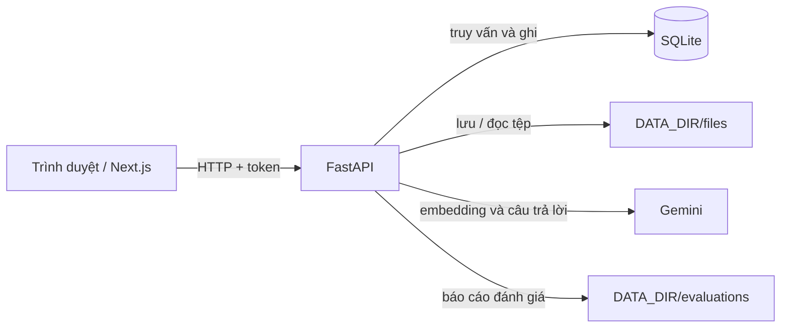

# Kiến trúc và cách hoạt động của dự án UTC RAG Chatbot

Tài liệu này mô tả mã nguồn hiện tại. Điểm khởi đầu là [README](../README.md), nơi có hướng dẫn cài đặt, cấu hình và vận hành.

## 1. Tổng quan

Ứng dụng có hai tiến trình chính: Next.js phục vụ giao diện và FastAPI cung cấp API. FastAPI sở hữu toàn bộ quy tắc nghiệp vụ, lưu dữ liệu trong SQLite và lưu tệp trên ổ đĩa. Gemini được gọi từ backend để tạo embedding và sinh câu trả lời. Trình duyệt không giữ khóa Gemini và không truy cập trực tiếp SQLite.

| Thành phần | Trách nhiệm | Trạng thái/dữ liệu |
| --- | --- | --- |
| Frontend Next.js | Chat công khai, tra cứu ngành, hướng dẫn tân sinh viên, quản trị | Token phiên chat ẩn danh trong localStorage; token quản trị trong sessionStorage; trạng thái màn hình trong React |
| FastAPI | Xác thực, kiểm tra đầu vào, điều phối RAG và các nghiệp vụ | Bộ giới hạn tần suất trong bộ nhớ tiến trình |
| SQLite | Tài khoản, phiên, hội thoại, tài liệu, đoạn và vector, ngành, hướng dẫn, phản hồi | DATA_DIR/utc.sqlite3 |
| Kho tệp cục bộ | Tệp nguồn đã tải lên và PDF hướng dẫn | DATA_DIR/files/ |
| Gemini | Tạo embedding và câu trả lời dựa trên ngữ cảnh | Dịch vụ AI bên ngoài |

**Ranh giới tin cậy:** mọi thao tác ghi dữ liệu quản trị đi qua API có token; trình duyệt chỉ nhận dữ liệu được API trả về. Khóa Gemini, mật khẩu cấu hình và tệp SQLite chỉ nằm ở backend. Câu hỏi và các đoạn nguồn được chọn được gửi đến Gemini trong luồng hỏi đáp; nội dung tài liệu được gửi khi tạo embedding.

### Luồng tổng thể

1. Quản trị viên đưa tệp, URL hoặc văn bản vào kho tài liệu.
2. Backend trích xuất văn bản, chia đoạn, tạo embedding và ghi từng đoạn vào SQLite.
3. Người dùng hỏi; backend chọn bộ lọc năm/cơ sở, tạo embedding câu hỏi và tìm các đoạn tương đồng trong tài liệu đang hoạt động.
4. Nếu có đoạn phù hợp, backend gọi Gemini để tạo câu trả lời có dẫn nguồn; nếu không, trả lời thiếu căn cứ.
5. Câu hỏi, câu trả lời và phản hồi của người dùng được lưu theo phiên chat.

Danh mục ngành và hướng dẫn tân sinh viên là hai luồng dữ liệu cấu trúc riêng. Việc sửa các bản ghi này không tự cập nhật kho đoạn RAG.

## 2. Cấu trúc mã nguồn

| Đường dẫn | Vai trò |
| --- | --- |
| [backend/app/config.py](../backend/app/config.py) | Đọc biến môi trường và cung cấp cấu hình |
| [backend/app/security.py](../backend/app/security.py) | Hash và kiểm tra mật khẩu quản trị |
| [backend/app/main.py](../backend/app/main.py) | Ứng dụng FastAPI, xác thực, chat, tài liệu, đánh giá phản hồi |
| [backend/app/rag.py](../backend/app/rag.py) | Trích xuất nguồn, lọc câu hỏi, embedding, truy xuất và sinh câu trả lời |
| [backend/app/localdb.py](../backend/app/localdb.py) | SQLite, kho tệp cục bộ, truy vấn và các RPC nghiệp vụ |
| [backend/app/majors.py](../backend/app/majors.py) | API và kiểm tra dữ liệu danh mục ngành |
| [backend/app/freshmen.py](../backend/app/freshmen.py) | API hướng dẫn tân sinh viên và PDF |
| [backend/app/evaluation.py](../backend/app/evaluation.py) | Chạy bộ câu hỏi đánh giá RAG và tính chỉ số |
| [backend/scripts/](../backend/scripts/) | Lệnh nhập dữ liệu, đổi mật khẩu, đánh giá RAG |
| [backend/tests/](../backend/tests/) | Kiểm thử API, dữ liệu cục bộ và đánh giá |
| [frontend/app/](../frontend/app/) | Các trang Next.js và bố cục |
| [frontend/components/](../frontend/components/) | Giao diện nghiệp vụ dùng lại |
| [frontend/lib/api.ts](../frontend/lib/api.ts) | Hàm gọi API và kiểu dữ liệu chung |
| [supabase/](../supabase/) | SQL của kiến trúc cũ; ứng dụng hiện tại không chạy các tệp này |

## 3. Backend

### 3.1. Cấu hình: app/config.py

Settings đọc biến môi trường và backend/.env qua Pydantic Settings; hàm settings() dùng bộ nhớ đệm để các module nhận cùng một bộ cấu hình trong tiến trình. Các nhóm cấu hình chính:

- DATA_DIR: thư mục SQLite, tệp gốc và báo cáo đánh giá. Đường dẫn tương đối được tính từ thư mục làm việc khi chạy backend.
- ADMIN_EMAIL và ADMIN_PASSWORD: tạo tài khoản quản trị đầu tiên khi đăng nhập lần đầu; sau đó tài khoản trong SQLite là nguồn sự thật.
- GOOGLE_API_KEY, GEMINI_MODEL, EMBEDDING_MODEL: các cuộc gọi AI từ backend.
- FRONTEND_ORIGIN: origin được phép qua CORS.
- SIMILARITY_THRESHOLD: ngưỡng khi truy xuất đoạn nguồn.

DEFAULT_YEAR cũng được khai báo trong cấu hình; giao diện chat hiện đặt mặc định năm 2026 tại frontend, chưa đọc giá trị đó qua API. Khi đổi mô hình embedding, các vector cũ không tự được tạo lại; cần lập chỉ mục lại tài liệu để so sánh cùng không gian vector.

### 3.2. Bảo vệ mật khẩu quản trị: app/security.py

security.py dùng scrypt với salt ngẫu nhiên cho mọi tài khoản và so sánh hash bằng phép so sánh có thời gian ổn định. Module `auth.py` cung cấp auth chung và RBAC: khách, sinh viên, giảng viên, admin. Khách truy cập các trang công khai không cần đăng nhập. Chi tiết schema, migration và quyền: [AUTH.md](AUTH.md).

### 3.3. API và điều phối: app/main.py

main.py khởi tạo FastAPI, CORS, các bộ xử lý lỗi và Database được giữ lại bằng bộ nhớ đệm. Module này giữ lớp điều phối HTTP, còn logic RAG nằm trong rag.py và lưu trữ nằm trong localdb.py.

**Auth chung.** `POST /auth/login` kiểm tra email và mật khẩu; `POST /auth/logout` thu hồi phiên; `GET /auth/me` trả vai trò/quyền; đăng ký chỉ cấp vai trò sinh viên. Nếu chưa có admin, đăng nhập bằng email bootstrap tạo tài khoản từ cấu hình sau khi kiểm tra mật khẩu dài ít nhất 16 ký tự và đã thay mẫu mặc định. Mật khẩu lưu bằng scrypt; SQLite chỉ giữ SHA-256 của token và thời điểm hết hạn 12 giờ. Các endpoint login/logout cũ vẫn là alias.

**RBAC.** `accounts` lưu role (`student`, `lecturer`, `admin`) và `is_active`; `guest` đại diện truy cập ẩn danh. `admin()` yêu cầu quyền đọc nội dung quản trị; `can_edit()` yêu cầu quyền ghi nội dung của giảng viên/admin; `owner()` yêu cầu quyền quản lý tài khoản chỉ dành cho admin. Sinh viên không truy cập API quản trị. Mọi thay đổi quyền, mật khẩu hoặc khóa tài khoản xóa phiên trong `auth_sessions`. Transaction `BEGIN IMMEDIATE` bảo vệ cập nhật đồng thời và admin hoạt động cuối cùng. Migration `accounts_v1` giữ ID/password hash của tài khoản cũ, đổi editor thành lecturer và viewer thành student; phiên cũ không còn hiệu lực.

**Rate limit: app/ratelimit.py.** Middleware chạy trước route, dùng IP từ ASGI scope và bốn ngưỡng cấu hình: toàn API, chat, đăng nhập, ghi quản trị. Khóa IP/ngưỡng được hash SHA-256; bộ đếm cửa sổ 60 giây nằm trong bảng `api_rate_limits` của SQLite. `BEGIN IMMEDIATE` giúp nhiều worker không ghi đè lượt đếm của nhau. Quá ngưỡng trả 429 và thời gian chờ; CORS bọc ngoài middleware để 429 vẫn có header CORS. OPTIONS và trang OpenAPI được bỏ qua. Bộ đếm cũ được dọn định kỳ.

**Phiên chat ẩn danh.** POST /sessions tạo token ngẫu nhiên, chỉ lưu SHA-256 của token trong chat_sessions và trả token cho trình duyệt. GET /messages, POST /chat và POST /feedback dùng header X-Session-Token; dependency session() tìm đúng phiên theo hash. Token không cấp quyền quản trị. Phản hồi chỉ cập nhật câu trả lời trong chính phiên đó. Nút tạo hội thoại mới bỏ token cũ ở trình duyệt và lần gửi tiếp theo tạo phiên mới.

**Luồng POST /chat.**

1. Kiểm tra phiên, giới hạn tần suất và dữ liệu ChatInput.
2. Dùng filters() trong rag.py để chọn năm và cơ sở từ câu hỏi và lựa chọn giao diện. Câu hỏi nêu rõ năm/cơ sở sẽ được ưu tiên; nêu hai năm hoặc hai cơ sở xung đột sẽ bị từ chối.
3. Nếu có khóa Gemini, tạo embedding câu hỏi rồi gọi match_chunks() để lấy tối đa 6 đoạn đạt ngưỡng từ tài liệu trạng thái ready.
4. Có đoạn phù hợp thì gọi generate(); không có đoạn thì dùng câu trả lời thiếu căn cứ.
5. Ghi hai message (user và assistant), nguồn trích dẫn và độ trễ; trả assistant message cho frontend.

Các lỗi Gemini tạm thời được xử lý thành lỗi API gọn cho trình duyệt. Bộ giới hạn tần suất tính theo IP trong bộ nhớ tiến trình, tối đa 20 yêu cầu mỗi 60 giây cho các route được gắn dependency; nó không chia sẻ trạng thái giữa nhiều tiến trình.

**Kho tài liệu.** POST /admin/documents/preview đọc tệp hoặc URL và trả nội dung trích xuất để kiểm tra trước. POST /admin/documents nhận văn bản và metadata; POST /admin/documents/upload nhận thêm tệp gốc. persist_document tính checksum từ năm, cơ sở và văn bản để phát hiện tài liệu trùng; ghi bản ghi processing; nếu có tệp gốc thì lưu vào kho tệp; sau đó đăng ký ingest() bằng FastAPI BackgroundTasks. ingest() chia văn bản thành tối đa 2.000 đoạn, tạo embedding theo lô 32, lưu document_chunks và chuyển trạng thái ready; nếu lỗi thì xóa các đoạn chưa hoàn chỉnh và đánh dấu failed. Có route liệt kê, tải tệp gốc, ẩn/hiện, thử lại và xóa. BackgroundTasks chạy trong tiến trình API, nên tác vụ đang chạy có thể bị ngắt nếu tiến trình dừng.

**Quan sát và rà soát.** GET /health báo configured khi đã có admin và khóa Gemini; đây không phải phép thử kết nối Gemini. GET /admin/review tổng hợp các câu hỏi thiếu nguồn và phản hồi để quản trị viên xem lại nội dung.

### 3.3. Xử lý RAG: app/rag.py

| Hàm/nhóm hàm | Cách hoạt động |
| --- | --- |
| filters() | Chuẩn hóa câu hỏi, nhận diện năm 20xx và địa điểm Hà Nội/TP. Hồ Chí Minh, kết hợp với lựa chọn trên giao diện; phát hiện bộ lọc mâu thuẫn |
| valid_url(), fetch_url() | Chỉ chấp nhận HTTPS trên các tên miền UTC cho phép, không theo redirect; tải HTML/PDF có giới hạn dung lượng và thời gian; loại phần HTML ít liên quan |
| extract() | Đọc PDF bằng pypdf hoặc TXT/MD UTF-8; giới hạn PDF 300 trang, nguồn 10 MB và yêu cầu ít nhất 30 ký tự; PDF ảnh cần OCR trước |
| chunks() | RecursiveCharacterTextSplitter, kích thước 1.200 ký tự, chồng 180 ký tự |
| embeddings() | Tạo adapter GoogleGenerativeAIEmbeddings, vector 768 chiều |
| match_chunks() | Tạo embedding câu hỏi, gọi RPC match_chunks của localdb.py với năm, cơ sở, ngưỡng và số lượng 6 |
| generate() | Gửi câu hỏi cùng các đoạn đã chọn cho Gemini, yêu cầu đầu ra cấu trúc gồm answer, source_ids, supported; kiểm tra ID trích dẫn và cờ supported trước khi trả |
| invoke_gemini() | Thử lại tối đa 3 lần cho lỗi tạm thời như 429 hoặc 5xx, với thời gian chờ tăng dần |

Nguồn trích dẫn chỉ lấy từ những đoạn đã truy xuất. Nếu mô hình không xác nhận câu trả lời được hỗ trợ hoặc ID nguồn không hợp lệ, backend trả câu trả lời thiếu căn cứ. Đây là kiểm tra theo cấu trúc và nguồn tham chiếu; độ đúng nội dung vẫn cần bộ đánh giá và rà soát thực tế.

### 3.4. Lưu trữ: app/localdb.py

connect() mở SQLite tại DATA_DIR/utc.sqlite3, bật foreign key và WAL, rồi bảo đảm schema tồn tại. Query cung cấp các phép select, insert, update, delete, upsert, lọc, sắp xếp và phân trang; mỗi execute() dùng một kết nối riêng. Một số cột JSON như nguồn, embedding, phương thức và tổ hợp môn được mã hóa khi ghi và giải mã khi đọc.

| Bảng | Dữ liệu chính và quan hệ |
| --- | --- |
| accounts, auth_sessions | Tài khoản sinh viên/giảng viên/admin và hash token đăng nhập |
| schema_migrations | Phiên bản migration đã áp dụng; bảng admins/admin_sessions cũ chỉ giữ để tham chiếu |
| chat_sessions, messages, feedback | Token hash của phiên ẩn danh, lịch sử hai vai trò và đánh giá câu trả lời |
| documents, document_chunks | Metadata tài liệu và các đoạn văn bản kèm embedding; đoạn thuộc một tài liệu |
| major_catalogue | Bản ghi ngành theo năm/cơ sở/mã, trường tìm kiếm và các trường JSON |
| freshman_guides, freshman_items | Hướng dẫn theo khóa và các mục thành phần |

Cơ sở dữ liệu từng chạy phiên bản tài khoản người dùng có thể còn bảng users và cột user_id trong chat_sessions. Backend giữ nguyên dữ liệu cũ nhưng không chuyển hội thoại gắn tài khoản thành phiên công khai.

Database.rpc() điều phối các thao tác đặc thù:

- match_chunks: chọn đoạn thuộc tài liệu ready và đúng năm/cơ sở, tính cosine bằng Python trên các vector đã lưu, lọc theo ngưỡng rồi xếp hạng lấy tối đa số lượng yêu cầu. Đây là quét tuyến tính; chi phí truy xuất tăng theo số đoạn.
- save_major và delete_major: thao tác ngành với quy tắc duy nhất.
- import_majors: nhập nhiều ngành trong một transaction, bỏ qua mục đã tồn tại theo năm/cơ sở/mã.

StorageBucket ghi tệp dưới DATA_DIR/files, kiểm tra đường dẫn để tránh thoát khỏi thư mục này; các thao tác upload, download, remove được dùng qua Database.storage. Tên bucket admission-documents chỉ là giao diện nội bộ cho kho tệp cục bộ, không phải dịch vụ đám mây.

### 3.5. Danh mục ngành: app/majors.py

Module định nghĩa MajorInput và các quy tắc kiểm tra mã, chỉ tiêu, URL nguồn, danh sách phương thức/tổ hợp. Frontend giữ tối đa ba bản ghi đã chọn trong trạng thái của MajorCatalogue, độc lập với phân trang/bộ lọc; bảng so sánh hiển thị trực tiếp từ dữ liệu API, không cần endpoint riêng. GET /majors và GET /majors/{id} chỉ trả ngành đang hoạt động cho người dùng; bộ lọc gồm từ khóa, năm, cơ sở và phân trang. Các route /admin/majors cho phép xem toàn bộ, thêm, sửa, xóa và nhập JSON.

parse_catalogue() đọc cấu trúc JSON theo các phần chỉ tiêu từng năm và cơ sở GHA/GSA, chuẩn hóa thành các bản ghi, phát hiện mã trùng và giới hạn số bản ghi nhập. Dữ liệu được lưu tại major_catalogue; tìm kiếm dùng trường search_text trong SQLite. Đây là danh mục cấu trúc riêng, không đi qua tạo embedding.

### 3.6. Hướng dẫn tân sinh viên: app/freshmen.py

Module quản lý guide theo khóa dạng K + chữ số và các item thuộc từng guide. Route công khai trả guide đã xuất bản và item đang hoạt động; route quản trị cho phép xem bản nháp, tạo/sửa/xóa guide và item, tải PDF lên. PDF được kiểm tra chữ ký %PDF-, giới hạn 10 MB và lưu dưới DATA_DIR/files/freshmen/<khóa>/ với tên ngẫu nhiên. Trang nguồn của item giúp frontend mở đúng trang PDF. PDF của guide đã xuất bản được đọc công khai; PDF bản nháp cần token quản trị. Khi xóa guide, item liên quan được xóa theo quan hệ dữ liệu và tệp PDF được dọn khỏi kho.

### 3.7. Bộ đánh giá RAG: app/evaluation.py

Bộ dữ liệu JSON phiên bản 1 gồm các ca với ID, câu hỏi, bộ lọc năm/cơ sở và kỳ vọng: có/không đủ nguồn, URL nguồn, câu trả lời tham chiếu và các cụm từ bắt buộc. load_dataset() kiểm tra schema và ID duy nhất; dataset_hash() gắn báo cáo với đúng nội dung bộ câu hỏi.

evaluate_case() dùng filters() và match_chunks() giống luồng chat để đo truy xuất. Chế độ đầy đủ còn gọi generate() để đo câu trả lời và trích dẫn; chế độ retrieval-only chỉ đo truy xuất, tiết kiệm lời gọi sinh. summarize() tính Hit@6, MRR, độ khớp trạng thái có nguồn, tỷ lệ trích dẫn đúng, tỷ lệ chứa cụm từ yêu cầu, tỷ lệ đạt và số lỗi. compare_reports() chỉ so sánh các báo cáo có cùng dataset hash, chế độ và embedding model. Báo cáo JSON ghi thời điểm, cấu hình, từng ca và chỉ số, mặc định trong DATA_DIR/evaluations/.

Đây là phép đo theo URL, cờ hỗ trợ và cụm từ; expected_answer là đáp án tham khảo cho người đọc, không phải phép chấm ngữ nghĩa tự động. Chạy đánh giá thật sẽ gọi Gemini và cần kho tài liệu đã được lập chỉ mục. Xem [hướng dẫn chạy](../README.md#bộ-đánh-giá-rag).

## 4. Frontend

### 4.1. Lớp HTTP: frontend/lib/api.ts

Module xác định base URL từ NEXT_PUBLIC_API_URL (mặc định localhost:8000), cung cấp hàm fetch có timeout 120 giây, xử lý JSON và chuyển lỗi xác thực/kiểm tra dữ liệu thành thông báo dễ đọc. Các kiểu Source và Message được dùng chung cho giao diện chat. Đây là client HTTP, không chứa khóa Gemini hoặc truy cập SQLite.

### 4.2. Trang chat: frontend/app/page.tsx

Trang client giữ danh sách message, câu hỏi, năm/cơ sở và trạng thái gửi. Khi mở trang, nó đọc token phiên từ localStorage và gọi GET /messages. Nếu chưa có token, lần gửi đầu tạo phiên bằng POST /sessions. Câu hỏi gửi đến POST /chat cùng bộ lọc; giao diện hiển thị phản hồi và danh sách nguồn. Người dùng có thể gửi đánh giá qua POST /feedback. Nút tạo hội thoại mới xóa token và nội dung màn hình; phiên cũ vẫn còn trong SQLite nhưng không còn được liên kết từ trình duyệt. Mặc định UI chọn năm 2026 và cơ sở Hà Nội.

### 4.3. Trang quản trị: frontend/app/admin/page.tsx

Trang client đăng nhập qua POST /admin/login, giữ token trong sessionStorage và gắn Authorization: Bearer cho các request quản trị. Nó điều khiển các tab tài liệu, rà soát, ngành và tân sinh viên. Với tài liệu, giao diện cho xem trước tệp/URL, xác nhận metadata, tải lên, xem trạng thái, tải tệp gốc, ẩn/hiện, thử lại hoặc xóa. Trang tải lại danh sách tài liệu và rà soát định kỳ 10 giây để thấy kết quả lập chỉ mục chạy nền. Khi đăng xuất, nó gọi POST /admin/logout và xóa token cục bộ.

### 4.4. Thành phần nghiệp vụ và các trang

| Module | Vai trò |
| --- | --- |
| [MajorCatalogue.tsx](../frontend/components/MajorCatalogue.tsx) | Tìm/lọc/phân trang ngành; khi được truyền token quản trị thì hiện thêm CRUD và nhập JSON |
| [FreshmanGuide.tsx](../frontend/components/FreshmanGuide.tsx) | Chọn khóa, xem các mục và PDF; ở chế độ quản trị có thêm thao tác guide/item và tải PDF qua token |
| [app/majors/page.tsx](../frontend/app/majors/page.tsx) | Gắn MajorCatalogue ở chế độ công khai |
| [app/freshmen/page.tsx](../frontend/app/freshmen/page.tsx) | Gắn FreshmanGuide ở chế độ công khai |
| [app/layout.tsx](../frontend/app/layout.tsx) | Bố cục gốc, metadata, ngôn ngữ tiếng Việt |
| [app/globals.css](../frontend/app/globals.css) | Kiểu dáng dùng chung |

Các trang công khai và quản trị dùng lại cùng thành phần, nhưng quyền truy cập thực sự được kiểm tra ở backend. frontend/package.json chứa lệnh dev, build, start và typecheck.

## 5. Công cụ nhập dữ liệu và kiểm thử

| Module | Cách hoạt động |
| --- | --- |
| [scripts/import_majors.py](../backend/scripts/import_majors.py) | Đọc JSON danh mục, kiểm tra định dạng; chỉ ghi SQLite khi có --apply, bỏ qua ngành đã tồn tại |
| [scripts/import_freshmen.py](../backend/scripts/import_freshmen.py) | Đọc dữ liệu K67 và PDF trong backend/data, kiểm tra số trang; chỉ ghi khi có --apply |
| [scripts/set_admin_password.py](../backend/scripts/set_admin_password.py) | Nhập email/mật khẩu mới, cập nhật hash và hủy các phiên admin cũ |
| [scripts/evaluate_rag.py](../backend/scripts/evaluate_rag.py) | CLI chạy bộ câu hỏi, tùy chọn retrieval-only, baseline, đường dẫn báo cáo và ngưỡng fail |
| [evaluations/dataset.example.json](../backend/evaluations/dataset.example.json) | Mẫu bộ câu hỏi; cần thay câu hỏi và URL nguồn đúng với dữ liệu đã nạp |
| [tests/](../backend/tests/) | Kiểm thử FastAPI, quy tắc ngành, hướng dẫn, SQLite cục bộ và phép tính đánh giá |

requirements.in liệt kê phụ thuộc trực tiếp của backend; requirements.txt là tập phiên bản đã khóa. Tệp .env.example trong từng phần mô tả cấu hình mẫu; tuyệt đối không đưa khóa thật vào frontend.

## 6. Vận hành và giới hạn kiến trúc

- Cần sao lưu cùng lúc DATA_DIR/utc.sqlite3 và DATA_DIR/files/ để giữ quan hệ giữa metadata và tệp. Báo cáo đánh giá trong DATA_DIR/evaluations/ có thể lưu riêng.
- SQLite phù hợp triển khai nhỏ với một backend chính; WAL giúp đọc/ghi đồng thời hơn, nhưng việc tìm vector hiện quét tuyến tính và xử lý lập chỉ mục chạy trong tiến trình API. Khi dữ liệu/tải tăng, cần tách hàng đợi công việc và thay bộ tìm vector phù hợp.
- Việc ẩn tài liệu loại các đoạn của nó khỏi truy xuất; bật lại không cần tạo embedding nếu các đoạn còn nguyên. Đổi embedding model hoặc thay nội dung nguồn cần lập chỉ mục lại.
- CORS chỉ cho phép FRONTEND_ORIGIN đã cấu hình. URL nhập từ web bị giới hạn vào HTTPS và tên miền UTC cho phép; tệp tải lên bị giới hạn định dạng/kích thước trong backend.
- Supabase SQL nằm trong thư mục lịch sử. Kiến trúc chạy hiện tại dùng localdb.py và không yêu cầu Supabase.

Đối với hợp đồng đầu vào/đầu ra chi tiết từng endpoint, mở tài liệu OpenAPI tự sinh tại /docs của backend đang chạy.

## Module tra cứu điểm chuẩn

- `backend/data/cutoffs_2024_2026.json` lưu mỗi ô điểm được công bố thành một bản ghi độc lập, gồm năm, cơ sở, mã xét tuyển, tên chương trình, phương thức, điểm, thang, tiêu chí phụ và URL thông báo UTC. Khóa logic là `(admission_year, campus, admission_code, method)`; điểm vắng mặt trong thông báo không được suy đoán.
- `backend/scripts/import_cutoffs.py` kiểm tra cấu trúc, giới hạn điểm theo thang, URL chính thức và khóa trùng trước khi nhập. `--apply` dùng một giao dịch SQLite với `INSERT OR IGNORE`, nên có thể chạy lại mà không sửa bản ghi cũ.
- `backend/app/localdb.py` tạo bảng `cutoff_scores` và chỉ mục cho các trường lọc. `backend/app/cutoffs.py` cung cấp hai endpoint công khai: danh sách phân trang và các lựa chọn bộ lọc (tên chương trình, năm, phương thức). Từ khóa được chuẩn hóa chữ thường, bỏ dấu tiếng Việt và ký tự đặc biệt của SQL `LIKE` được escape.
- `frontend/components/CutoffLookup.tsx` gọi API khi một trong bốn dropdown thay đổi, hiển thị bảng gồm điểm/thang và liên kết nguồn từng dòng. Trang `/cutoffs` được gắn trong sidebar chung. Bảng cuộn ngang trên màn hình nhỏ; phân trang giữ tối đa 25 bản ghi mỗi lần gọi.

Luồng dữ liệu: thông báo UTC → JSON đã đối chiếu → bộ nhập kiểm tra → SQLite → `GET /cutoffs` → trang tra cứu. Tất cả truy vấn đọc không yêu cầu token; middleware rate limit chung vẫn áp dụng.
